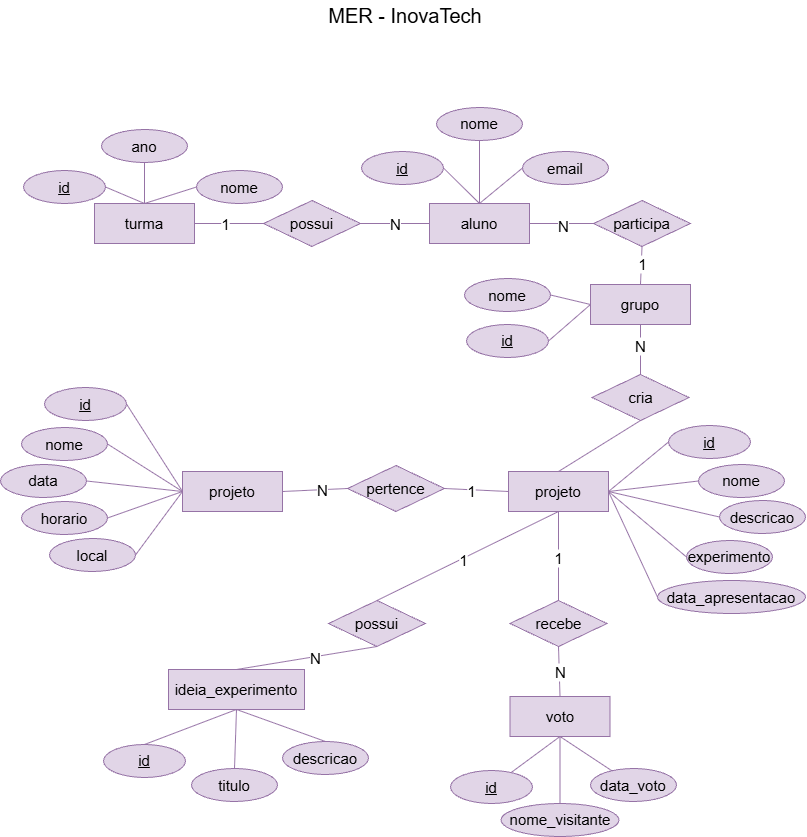
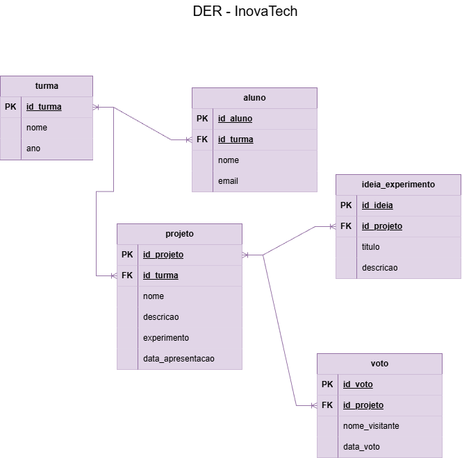

# Banco de Dados, MER e DER

## 1. Banco de Dados

Nesta seção, será apresentada a estrutura do banco de dados do projeto.

```
CREATE DATABASE projetos;

USE projetos;

CREATE TABLE projeto (
    id INT AUTO_INCREMENT PRIMARY KEY,
    nome VARCHAR(100) NOT NULL,
    aluno VARCHAR(100),
    turma VARCHAR(20),
    tema VARCHAR(100)
);

USE projetos;

INSERT INTO projeto (nome, aluno, turma, tema)
VALUES
('Energia Solar', 'Ana', '2º A', 'Sustentabilidade'),
('Filtro de Água', 'Lucas', '1º B', 'Meio Ambiente'),
('Vulcão Experimental', 'Bruna', '1º A', 'Química'),
('Horta Sustentável', 'Rafael', '2º B', 'Biologia'),
('Efeito Estufa', 'Júlia', '3º A', 'Meio Ambiente'),
('Robô Reciclável', 'Gabriela', '3º B', 'Tecnologia');

USE projetos;

SELECT * FROM projeto;

SELECT * FROM projeto;

USE projetos;

SHOW TABLES;

USE projetos;

CREATE TABLE IF NOT EXISTS projeto (
    id INT AUTO_INCREMENT PRIMARY KEY,
    nome VARCHAR(100) NOT NULL,
    aluno VARCHAR(100),
    turma VARCHAR(20),
    tema VARCHAR(100)
);


INSERT INTO projeto (nome, aluno, turma, tema)
VALUES
('Energia Solar', 'Ana', '2º A', 'Sustentabilidade'),
('Filtro de Água', 'Lucas', '1º B', 'Meio Ambiente'),
('Vulcão Experimental', 'Bruna', '1º A', 'Química'),
('Horta Sustentável', 'Rafael', '2º B', 'Biologia'),
('Efeito Estufa', 'Júlia', '3º A', 'Meio Ambiente'),
('Robô Reciclável', 'Gabriela', '3º B', 'Tecnologia');

SELECT * FROM projeto;
```
## 2. MER — Modelo Entidade-Relacionamento

O MER representa as entidades, os atributos e os relacionamentos do sistema.



## 3. DER — Diagrama Entidade-Relacionamento

O DER representa graficamente a estrutura do banco de dados, incluindo entidades, atributos, chaves primárias (PK), chaves estrangeiras (FK) e relacionamentos.



---

Desenvolvido para fins acadêmicos.
